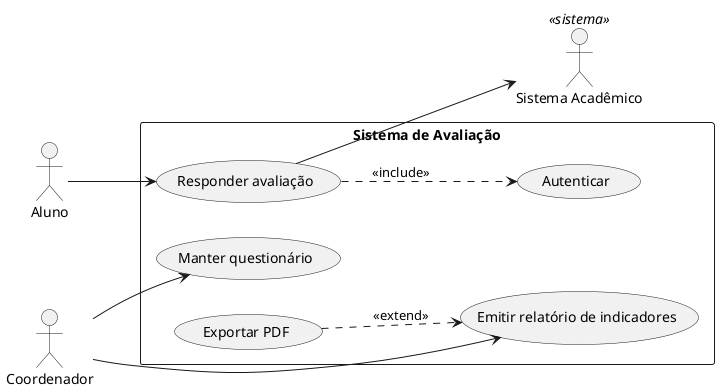
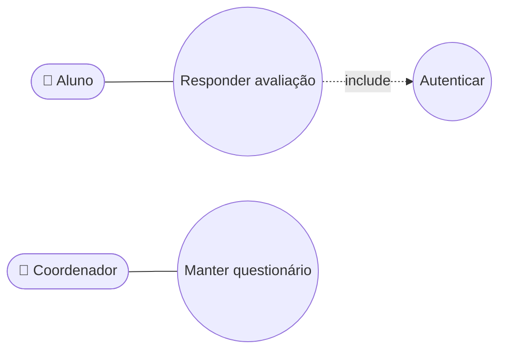
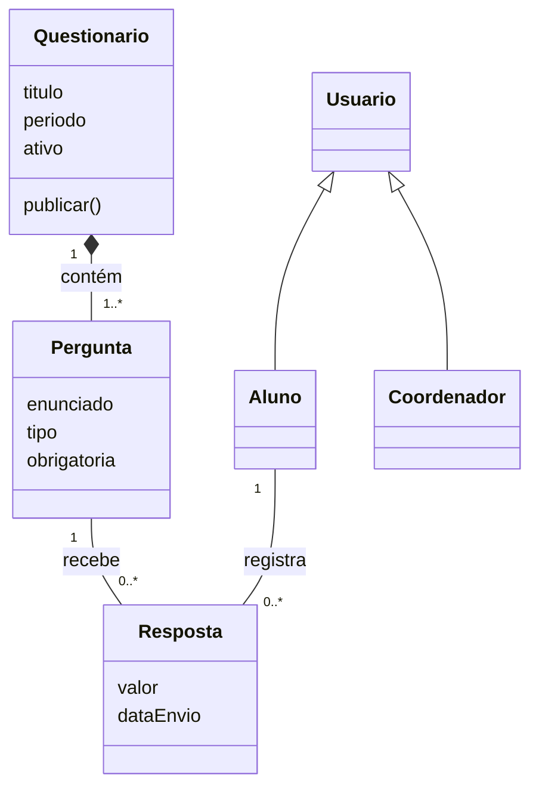
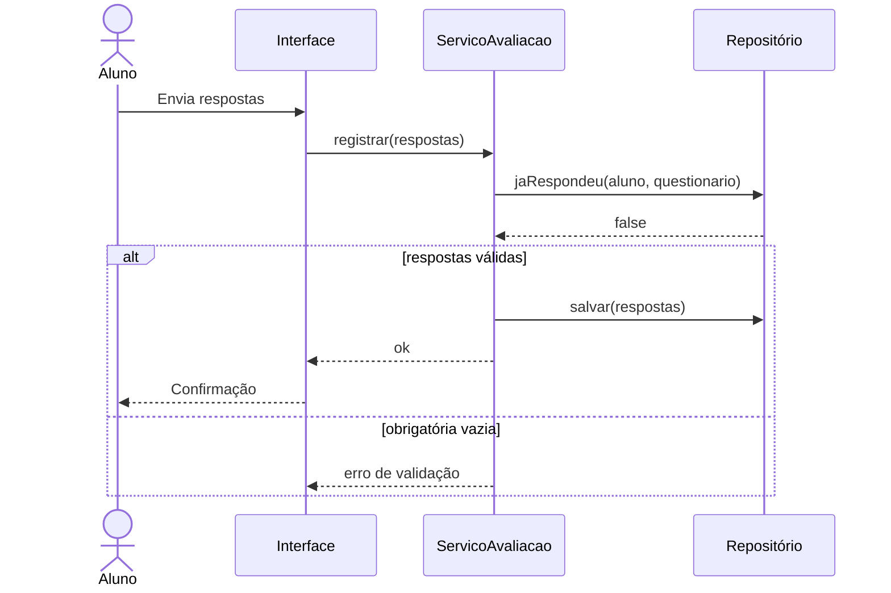
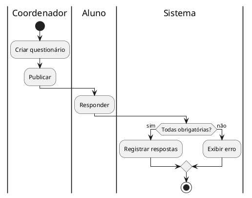
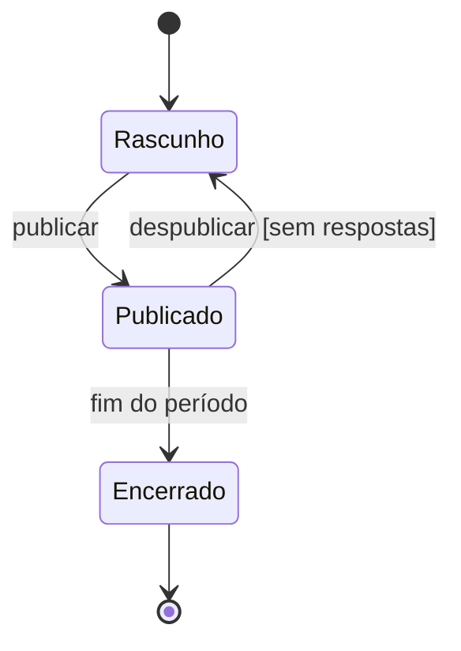
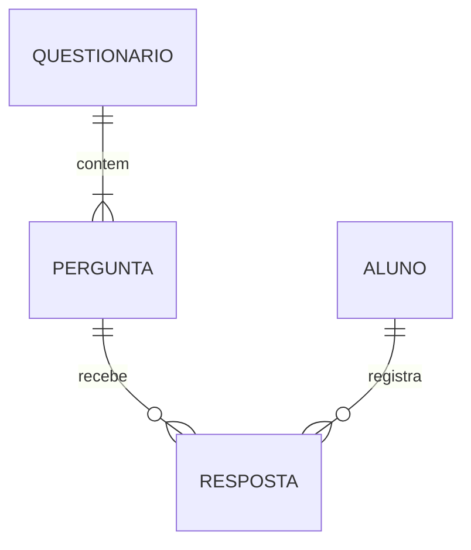
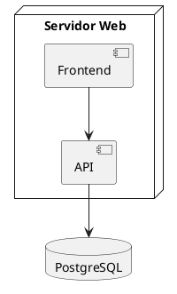

# Sintaxe UML — Mermaid e PlantUML

## Casos de uso (PlantUML — Mermaid não tem suporte nativo)

Alternativa em Mermaid (aproximação com flowchart, quando só Mermaid renderiza):

## Classes (domínio)

Relações: `<|--` herança, `*--` composição, `o--` agregação, `-->` associação dirigida, `..>` dependência, `..|>` realização.

## Sequência

## Atividades (com raias)

Em Mermaid use `flowchart TD` com `subgraph` por raia.

## Máquina de estados

## Entidade-Relacionamento

## Componentes / Implantação (PlantUML)

## Dicas
- Mermaid: evite acentos/espaços em identificadores; use rótulos entre aspas ou `id["Rótulo"]`.
- Mantenha cada diagrama focado (≤ ~15 elementos); divida por módulo se crescer.
- Legende decisões não óbvias logo abaixo do diagrama.
