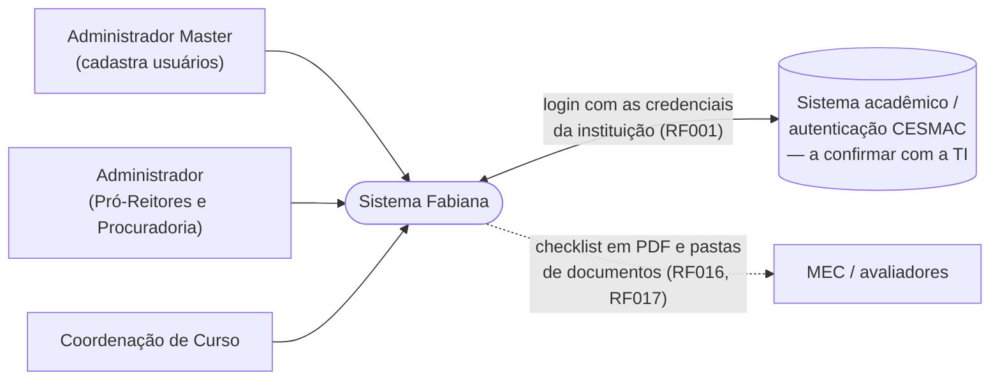
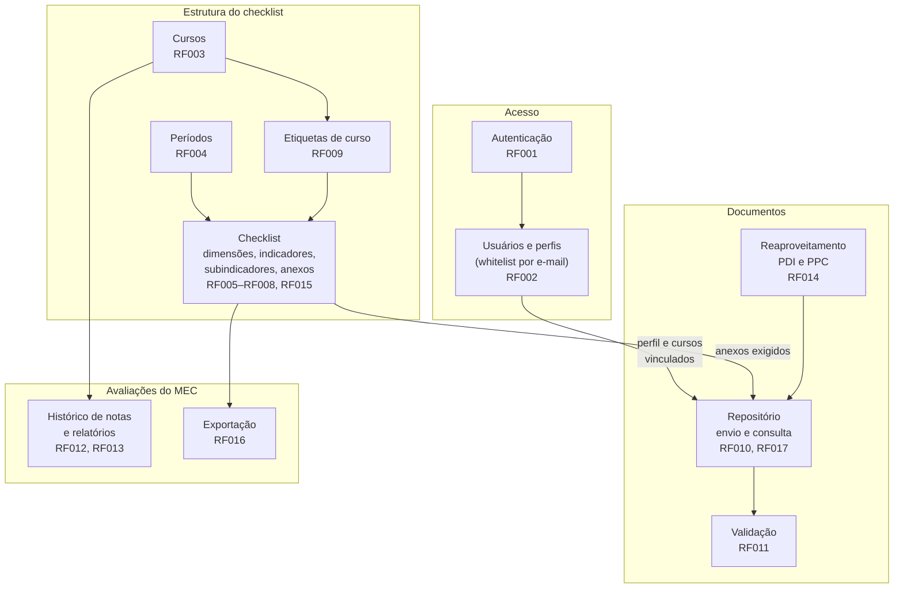
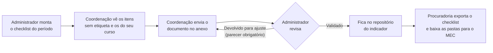

# Documentação – Projeto Fabiana

Sistema de avaliação e indicadores de qualidade do ensino superior do CESMAC, desenvolvido pelo CITEC para a Procuradoria Institucional. Ele substitui o processo manual de montar o checklist do MEC e reunir os documentos que comprovam cada indicador.

## Situação atual

| Item | Situação |
|---|---|
| Levantamento de requisitos | **Concluído – v5.1 (12/11/2026)**, RF001–RF017, baseado no fluxo de telas da equipe |
| Validação com a Fabiana | Aguardando: ela precisa aprovar as mudanças A–G e responder as perguntas em `requisitos/pendencias.md` |
| Arquitetura | Decidida em 12/11/2026: Java, monolito modular, frontend Thymeleaf em módulo separado no mesmo repositório (seção abaixo) |
| Protótipo / código | Não iniciado; repositório criado (`main` e `develop`), sem código ainda |

## O que tem aqui

```
docs/
├── README.md               ← este arquivo
├── prd.md                 ← visão de produto: problema, objetivos, usuários, funcionalidades, fases
├── glossario.md            ← termos do MEC/INEP, da instituição e do sistema
├── fontes/                 ← material recebido (não editar)
│   ├── transcricao-reuniao-projeto-mozart.pdf
│   ├── instrumento-inep-2017-reconhecimento-curso.pdf
│   ├── esboco-gerencia-checklist-2026-11-06.png
│   ├── fluxo-telas-sistema-fabiana.jpg
│   ├── checklist-medicina/
│   └── miro/
└── requisitos/             ← o que a equipe produziu
    ├── Levantamento de requisitos - Projeto Fabiana.docx
    ├── Levantamento de requisitos - Projeto Fabiana.pdf
    └── pendencias.md
```

### Fontes

| Arquivo | O que é |
|---|---|
| `transcricao-reuniao-projeto-mozart.pdf` | Reunião com a Fabiana (Procuradoria Institucional): contexto da avaliação do MEC, checklist, repositórios, histórico de notas e acesso. O sistema ainda se chamava Mozart. |
| `instrumento-inep-2017-reconhecimento-curso.pdf` | Instrumento do INEP (2017) para reconhecimento de curso: 3 dimensões, indicadores, critérios de 1 a 5 e regras de NSA. |
| `esboco-gerencia-checklist-2026-11-06.png` | Primeiro esboço das telas de Gerência de Checklist (06/11/2026). |
| `fluxo-telas-sistema-fabiana.jpg` | Fluxo de telas da equipe (login e painel do administrador). Base da v5 dos requisitos. |
| `checklist-medicina/` | Checklist real de Medicina feito pela Procuradoria (`original.doc`) e a versão corrigida, com uma linha por indicador (`corrigido.docx/.pdf`). |
| `miro/` | Prints das telas no Miro (12/11/2026): login, períodos, dimensões, indicadores e anexos. **São só exemplos para entender o fluxo, não o design final.** |

### Requisitos

| Arquivo | O que é |
|---|---|
| `Levantamento de requisitos - Projeto Fabiana.docx` | **Documento oficial.** Segue o modelo do TCC. Tem os requisitos funcionais (RF001–RF017) e a matriz de rastreabilidade; as seções de RNF, segurança, riscos e ponto de função estão só com os títulos. |
| `Levantamento de requisitos - Projeto Fabiana.pdf` | O mesmo documento em PDF, para leitura e envio. |
| `pendencias.md` | Mudanças que a Fabiana precisa aprovar, perguntas em aberto, suposições adotadas e pesquisas recomendadas. |

## Arquitetura do sistema

### Definido (12/11/2026)

| Tema | Decisão |
|---|---|
| Linguagem | **Java** |
| Estilo | **Monolito modular**: uma única aplicação, dividida em módulos de negócio que não acessam as partes internas uns dos outros. Microsserviços foram descartados: poucos usuários, módulos muito dependentes entre si e equipe pequena. |
| Backend | **Clean Architecture** em cada módulo: regras no domínio (Java puro), casos de uso na aplicação, banco/arquivos/integrações nos adaptadores; dependências só apontam para dentro (skill `.claude/skills/backend/`) |
| Telas | **Thymeleaf + htmx**, cores do projeto **branco, azul e amarelo** + **semafóricas** (verde, amarelo, vermelho) só para estados (mudar cor exige aprovação), **WCAG 2 nível AA**, **mobile first** (skill `.claude/skills/frontend/`) |
| Repositório | **Um só** (monorepo), com o backend e o frontend em pastas separadas |
| Frontend | **Thymeleaf** (telas geradas pelo servidor), em módulo próprio, separado das regras de negócio |
| Qualidade | **Code review** obrigatório (PR com aprovação; `main` protegida no GitHub, com exceção justificada pelo desenvolvedor), **clean code** e **testes** executados no CI a cada PR |

### Sugestões iniciais (podem ser trocadas)

Ponto de partida proposto em 12/11/2026. **Não são decisões fechadas:** quem assumir o desenvolvimento pode trocar qualquer item, desde que registre aqui o que escolheu e por quê.

| Tema | Sugestão | Motivo |
|---|---|---|
| Versão do Java | Java 21 (LTS) | Versão de suporte longo atual |
| Framework e build | Spring Boot + Maven | O Thymeleaf é nativo do Spring; o Maven é o build mais conhecido |
| Banco de dados | PostgreSQL, com migrações versionadas (Flyway) | Gratuito e bem suportado pelo Spring e pelo Testcontainers |
| Arquivos enviados | Armazenamento compatível com S3, usando MinIO no servidor da faculdade | São centenas de arquivos por curso; se forem para a nuvem, o código não muda |
| Testes e qualidade | JUnit 5, Testcontainers, Spring Modulith ou ArchUnit, Spotless e Checkstyle | Cobrem as práticas listadas abaixo |

Organização proposta do repositório (a criar):

```
fabiana/
├── docs/                 ← esta documentação
├── backend/              ← regras de negócio e dados (sem telas)
│   └── br.cesmac.fabiana
│       ├── acesso/       ← RF001–RF002
│       ├── estrutura/    ← RF003–RF009, RF015
│       ├── documentos/   ← RF010, RF011, RF014, RF017
│       └── avaliacoes/   ← RF012, RF013, RF016
│           (cada módulo: domain/ · application/ · adapters/ · config/ — Clean Architecture)
└── frontend/             ← controllers web, templates Thymeleaf, CSS e JS
```

O frontend depende do backend, e o backend não conhece o frontend. No fim, os dois viram **um único executável**, porque o Thymeleaf roda dentro da mesma aplicação Java.

Como manter a qualidade:
- **Testes unitários** nas regras de negócio (ex: NSA automático, numeração dos indicadores, visibilidade por etiqueta de curso).
- **Testes de integração** com banco de dados real em container.
- **Testes de arquitetura**, que quebram o build se um módulo usar uma classe interna de outro, ou se o backend depender do frontend.
- **Formatador e linter automáticos** no CI, para o review não gastar tempo com estilo.

Ainda a decidir:

| Tema | Por que importa |
|---|---|
| Login com o sistema acadêmico / “Entrar com CESMAC” | Depende da TI (pendência 5) |
| Hospedagem e CI | Onde o sistema roda e onde ficam o repositório e os PRs |

### Fluxo de trabalho (Git)

- `main` = produção; `develop` = integração. Ninguém faz commit direto nelas.
- Cada funcionalidade ou correção nasce numa branch `tipo/descricao` saindo da `develop` (ex: `feat/cadastro-de-periodos`, `fix/upload-pdf-grande`).
- Commits **em português ou inglês** (o desenvolvedor escolhe; o `/commit` pergunta) no padrão **Conventional Commits** (`feat(estrutura): cria cadastro de períodos`), com `Refs: RF00X` quando ligado a um requisito.
- Ao terminar, abre-se um **PR para a `develop`** no GitHub. Ele só entra com o CI verde e a aprovação de outro desenvolvedor (merge com squash).
- Entrega: PR `develop → main`. Bug urgente: branch `hotfix/` saindo da `main`, com PR para a `main` e depois para a `develop`.

O passo a passo completo e a configuração inicial do GitHub estão na skill `.claude/skills/git/` (comando `/git`). O formato dos commits está na skill `.claude/skills/commit/` (comando `/commit`).

Os padrões de clean code, testes e code review, e um CI de exemplo, estão na skill `.claude/skills/qualidade-codigo/`.

**Agentes de IA:** quem usa o Claude Code tem tudo em `CLAUDE.md` e `.claude/`. Quem usa o Google Antigravity (ou outra ferramenta que lê `AGENTS.md`) tem a mesma configuração em `AGENTS.md` e `.agents/`. Os comandos `/ajuda`, `/git`, `/commit`, `/revisar` e `/session` existem nas duas; comece pelo `/ajuda`.

### Visão lógica

Os diagramas abaixo mostram *o que* o sistema faz e *com quem* conversa. Cada bloco aponta os RFs de onde saiu.

#### Contexto: quem usa e com o que o sistema conversa



- O MEC **não acessa** o sistema: a Procuradoria exporta o checklist e baixa as pastas para entregar (pendência 1c).
- A ligação com o sistema acadêmico depende da TI (pendência 5). Também não se sabe se os cursos virão de lá ou serão cadastrados à mão.

#### Módulos



| Módulo | Responsabilidade | Quem usa |
|---|---|---|
| Autenticação | Entrada com usuário e senha do sistema acadêmico ou “Entrar com CESMAC”; só entra quem está na whitelist | Todos |
| Usuários e perfis | Whitelist por e-mail, perfil (Master / Administrador / Coordenação) e cursos de cada coordenação | Administrador Master |
| Cursos | Cadastro com modalidade, área da saúde e DCN; define o NSA automático | Administrador |
| Períodos | Abertura do período copiando o anterior ou começando vazio | Administrador |
| Checklist | Dimensão → Indicador → Subindicador → Anexo, um checklist por período, comum a todos os cursos | Administrador (edita), Coordenação (consulta) |
| Etiquetas de curso | Decidem que itens cada curso vê; sem etiqueta, vale para todos | Administrador |
| Repositório | Guarda os documentos por dimensão e por indicador; um documento pode comprovar vários indicadores; baixa as pastas por anexo | Coordenação (envia), Administrador (consulta e baixa) |
| Validação | Validar ou devolver com parecer, em uma etapa só | Administrador |
| Reaproveitamento | Versões de PDI e PPC, sem apagar as anteriores; documento de período anterior volta para revisão | Não definido no RF014 |
| Histórico de notas | Notas fracionadas e relatórios do MEC por curso, dimensão e indicador; comparativo de evolução e fragilidades | Administrador |
| Exportação | Checklist do curso em PDF | Administrador |

#### Caminho de um documento



## Requisitos funcionais

| ID | Assunto |
|---|---|
| RF001 | Acesso ao sistema (login) |
| RF002 | Usuários autorizados (whitelist e perfis) |
| RF003 | Cadastro de cursos |
| RF004 | Períodos de avaliação |
| RF005 | Tela de Gerência de Checklist |
| RF006 | Dimensões |
| RF007 | Indicadores |
| RF008 | Anexos (documentos exigidos) |
| RF009 | Etiquetas de curso no checklist |
| RF010 | Envio de documentos comprobatórios |
| RF011 | Revisão e validação dos documentos |
| RF012 | Registro do histórico de avaliações do MEC |
| RF013 | Consulta do histórico e da evolução |
| RF014 | Histórico e reaproveitamento de documentos (PDI e PPC) |
| RF015 | Subindicadores |
| RF016 | Exportação do checklist do curso |
| RF017 | Consulta aos repositórios por dimensão e por indicador |

## Como alterar o documento de requisitos

O `.docx` é gerado por script, não editado à mão:

1. Edite o conteúdo em `.claude/gerador-docx/conteudo.py`.
2. Rode `.claude/gerador-docx/gerar.sh`.

O script usa como molde o documento do TCC (`.claude/gerador-docx/modelo-tcc.docx`). Novos requisitos entram no fim da lista, e os IDs nunca são renumerados; um requisito removido fica marcado como `[CANCELADO]`.

## Próximos passos

1. Validar o documento com a Fabiana e atualizar `pendencias.md` com as respostas.
2. Fechar os itens “Ainda a decidir” da arquitetura.
3. Criar a estrutura acima no repositório, e o CI (build, testes e linter). A `main` já está protegida; a `develop`, não.
4. Começar pelas telas de login, períodos e checklist (RF001–RF009), que são a base das outras.

## Para quem assume o projeto

Ordem de leitura sugerida:
1. Este README (situação, arquitetura e próximos passos).
2. `prd.md`, a visão geral do produto (problema, objetivos, MVP e fases).
3. `glossario.md`, para entender os termos do MEC e do sistema.
4. `requisitos/Levantamento de requisitos - Projeto Fabiana.pdf`, com os requisitos completos.
5. `requisitos/pendencias.md`, com o que ainda falta perguntar à Fabiana e as suposições adotadas.
6. `fontes/transcricao-reuniao-projeto-mozart.pdf` e `fontes/miro/`, com a origem de tudo.

A partir das telas do Miro, os requisitos seguem o fluxo de telas montado pela equipe anterior. Qualquer ponto que contrarie a transcrição está registrado em `pendencias.md` e precisa da aprovação da Fabiana.
